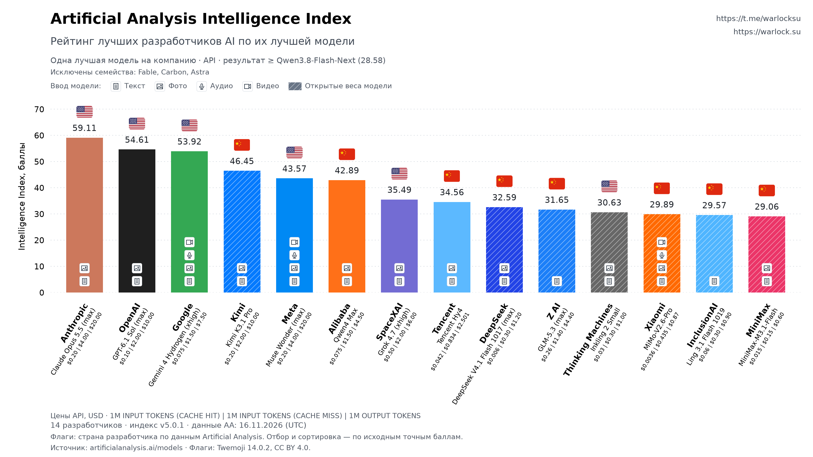
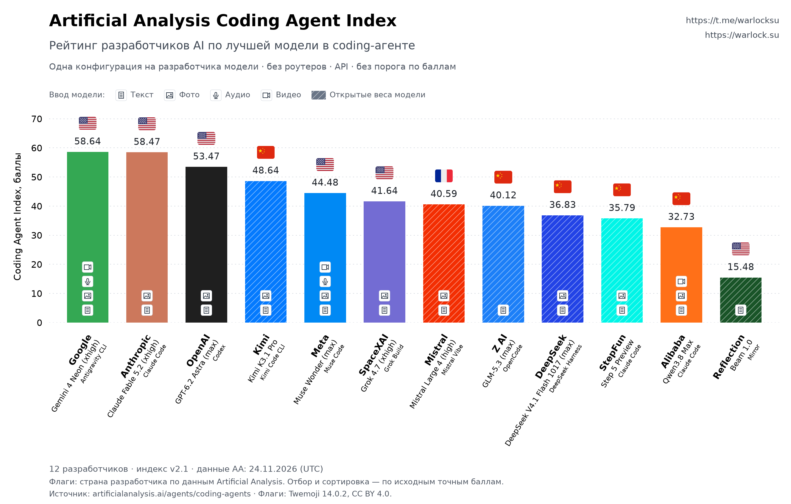

# AI Fair Rating

**Один разработчик — одна лучшая измеренная модель, доступная по API.**

Skill и один Python-скрипт строят два рейтинга: [Artificial Analysis Intelligence Index](https://artificialanalysis.ai/evaluations/artificial-analysis-intelligence-index) и [Artificial Analysis Coding Agent Index](https://artificialanalysis.ai/agents/coding-agents). Режимы и версии одной компании не занимают несколько мест на графике.

Данные опубликованных графиков: **16 ноября 2026**. Intelligence Index v5.0.1 — **14 разработчиков**, порог Qwen3.8-Flash-Next — **28,58 балла**, исключены Fable, Carbon и Astra. Coding Agent Index v2.1 — **12 разработчиков**. Qwen4 Max представляет Alibaba в Intelligence Index: **42,89 балла, 6-е место**. В Coding Agent Index результата Qwen4 Max пока нет; Alibaba представляет Qwen3.8 Max.





Автор: [Telegram](https://t.me/warlocksu) · [warlock.su](https://warlock.su)

## Как выбираются модели

1. Загружается полный публичный каталог [Artificial Analysis](https://artificialanalysis.ai/models). Каталог страницы сравнения `/models/comparisons` больше не содержит стран разработчиков.
2. Остаются только числовые результаты; записи без балла исключаются. AA больше не публикует признак оценочного балла, поэтому любой числовой балл считается результатом измерения (так же и в Coding Agent Index).
3. У модели должен быть хотя бы один API-провайдер в каталоге AA: **`hostModelCount > 0`**, и она **не должна иметь пометку «No publicly available API»**. В текущем формате AA публикует явный список провайдеров `hosts`: при свежей загрузке скрипт проверяет его структуру и уникальность slug, сохраняет список и записывает его длину в `hostModelCount`. Если источник также передаёт число, оно должно совпадать с длиной списка. Сохранённые снимки не дополняются задним числом. Явная пометка имеет приоритет над числом провайдеров. Отсутствие данных или неверный формат вызывают понятную ошибку. Доступность не определяется по цене, названию модели, открытым весам или одному лишь числу провайдеров.
4. Для всех компаний разрешены любые доступные по API режимы рассуждения, включая **max**. Только в Intelligence Index по запросу автора исключены семейства **Fable, Carbon и Astra**: отдельные слова в исходном названии AA без учёта регистра, все релизы и режимы. Исключения указаны на графике и в `metadata.json` как `excluded_model_families`.
5. По `creator.id` выбирается одна модель с максимальным исходным баллом среди оставшихся подходящих моделей.
6. Минимальный результат — **текущий балл Qwen3.8-Flash-Next** (релиз `qwen3-8-flash-next`, название запрошенной Qwen3.8 Flash в AA) в лучшем доступном по API режиме. Проходят модели с таким же или более высоким баллом. Порог пересчитывается из того же снимка AA при каждом запуске; фиксированного числа нет. Отбор и сортировка выполняются до округления; подписи показывают два знака.

Qwen3.8-Flash-Next выбрана опорной моделью для отсечения Intelligence Index. На графике указаны опорная модель и её балл; в `metadata.json` сохраняются точный балл, режим, slug и ссылка. Если числового API-результата опорной модели нет, скрипт выдаёт ошибку, не заменяя порог старым числом. Отдельный столбец для опорной модели не добавляется, если у Alibaba есть более сильная подходящая модель.

Страны и названия разработчиков берутся из самого источника. Количество компаний меняется с обновлением данных. Это сравнение достижений в одном индексе при указанных настройках; оно не утверждает равный вычислительный бюджет или доступность модели в определённой подписке. Название режима max само по себе не доказывает мультиагентность.

Например, Muse Wonder Full не проходит общий фильтр из-за явной пометки AA об отсутствии публичного API. Для Meta выбирается обычная Muse Wonder. Если Full станет доступна по API согласно данным AA и получит лучший измеренный балл, она сможет попасть в рейтинг без изменения правил или кода.

AA хранит список моделей с пометкой «No publicly available API» отдельно от каталога провайдеров — в публичном JavaScript-клиенте сайта. Скрипт читает этот список как данные, сопоставляет точные ID и сохраняет признак `aa_public_api_unavailable` в снимке. Список, ссылка на его источник и хеш исходного файла записываются в метаданные обоих рейтингов. Одинаковые копии списка в нескольких JavaScript-файлах допускаются только при полном совпадении наборов ID; ссылки и хеши всех копий сохраняются в `public_api_markers.sources`. Если списки расходятся или их формат меняется, построение завершается с ошибкой. Старые снимки без признака нужно получить заново обычным запуском без `--snapshot`; при воспроизведении используются только сохранённые пометки.

Значки внутри столбцов показывают поддерживаемый **ввод выбранной модели** по данным AA: снизу вверх — текст, фото, аудио, видео. Показываются только поддерживаемые типы. Источник — булевы поля `inputModalityText`, `inputModalityImage`, `inputModalitySpeech`, `inputModalityVideo`; отсутствие или неверный формат поля вызывает ошибку. Значки нарисованы векторно в самом скрипте, без дополнительных загрузок и шрифтов. Размер значков на столбцах и в легенде — 15,36 pt (38,4 пикселя при 180 dpi); линии уменьшены пропорционально. Просвет между значками на столбцах — 3,92 pt. При проверке размещения учитывается фактическая высота всей группы значков. Легенда собрана по ширине содержимого: 5 pt между значком и его подписью, 14 pt между пунктами. Образец «Открытые веса модели» имеет размер 19,2 × 11,52 pt. Размер флагов сохранён.

**Диагональная штриховка** поверх цвета столбца означает открытые веса выбранной модели: `isOpenWeights == true` в данных AA. Признак сохраняется в CSV как `open_weights`; отсутствие или неверный формат исходного поля вызывает ошибку.

В обоих графиках название разработчика набрано жирным шрифтом 12 pt, название модели — 10 pt, третья строка — 8 pt. Подписи сдвинуты на 5 пикселей влево при экспорте PNG в 180 dpi. В Intelligence Index третья строка показывает цены API из каталога AA в USD за миллион токенов. Порядок — кэшированный ввод, ввод без попадания в кэш, вывод. Тире обозначает отсутствующую цену. В Coding Agent Index третья строка показывает оболочку.

## Как выбираются coding-агенты

Группировка остаётся по **разработчику модели**, а в подписи дополнительно указывается агентная оболочка. Поэтому Qwen в Claude Code относится к Alibaba, а GLM в OpenCode — к Z AI. Смешанные роутеры (`isRouter == true`), например Devin Fusion и Copilot Fusion, исключаются; конфигурации `isUnavailable == true` также не допускаются.

Для Coding Agent Index берётся опубликованный `indexScore × 100` без округления до отбора. Принимается любой числовой балл; записи без балла исключаются. Балл вне исходной шкалы 0..1 вызывает ошибку.

Модель сопоставляется с полным каталогом по разработчику и точному имени/короткому имени без учёта регистра. Релизы и режимы не подменяются; неоднозначность вызывает ошибку. Из каталога берутся доступность API (`hostModelCount > 0` и отсутствие пометки «No publicly available API»), страна, открытые веса и типы ввода. Балл Intelligence Index при этом не используется: для coding-рейтинга он может отсутствовать. После отбора выбирается одна лучшая конфигурация на разработчика, **без порога по баллам**, включая нулевые результаты. Порог Qwen3.8-Flash-Next и исключения Fable, Carbon, Astra действуют только в Intelligence Index.

Иконки ввода и штриховка описывают модель, а не дополнительные возможности оболочки.

## Запуск

Нужен Python 3.10+; API-ключ не требуется.

```bash
git clone https://github.com/MetaWarlock/ai-fair-rating.git
cd ai-fair-rating
python -m venv .venv
```

Активировать окружение:

```powershell
# Windows PowerShell
.venv\Scripts\Activate.ps1
```

```bash
# macOS / Linux
source .venv/bin/activate
```

Установить зависимости и построить оба свежих рейтинга одним запуском:

```bash
python -m pip install -r skills/ai-fair-rating/requirements.txt
python skills/ai-fair-rating/scripts/rating.py --output output
```

В `output/` появятся:

| Файл | Содержимое |
| --- | --- |
| `rating.png` | График для публикации |
| `rating.svg` | Масштабируемая версия; контакты кликабельны |
| `rating.csv` | Модели, страны, точные баллы, режимы, число API-провайдеров, типы ввода (`text;image;audio;video`), открытые веса и ссылки |
| `metadata.json` | Дата получения данных, версия индекса, опорная модель и точный порог, правила и проверка вёрстки |
| `snapshot.json` | Исходный снимок для воспроизводимого построения |

Это результаты Intelligence Index. В `output/coding-agents/` создаются такие же пять файлов для Coding Agent Index; его CSV дополнительно содержит название оболочки и идентификатор конфигурации. В coding-метаданных есть причины исключения конфигураций, дата и хеш каталога моделей для проверки API и визуальных атрибутов. Полные снимки обоих источников остаются локально и не входят в Git.

Повторить построение без обновления данных AA:

```bash
python skills/ai-fair-rating/scripts/rating.py --snapshot output/snapshot.json --agents-snapshot output/coding-agents/snapshot.json --output output/replay
```

Дата исходного снимка сохраняется. Порог Intelligence Index берётся у Qwen3.8-Flash-Next из этого же снимка. Новые флаги при необходимости загружаются отдельно; уже используемые флаги входят в skill.

Необязательные параметры:

```bash
python skills/ai-fair-rating/scripts/rating.py --telegram https://t.me/yourname --website https://example.com
python skills/ai-fair-rating/scripts/rating.py --only models
python skills/ai-fair-rating/scripts/rating.py --only coding-agents
```

## Использование как skill

Скопируйте целиком папку [`skills/ai-fair-rating`](skills/ai-fair-rating) в каталог skills своего AI-агента. В ней уже находятся инструкции, скрипт, зависимости и флаги; остальной репозиторий для работы skill не нужен.

Пример запроса:

> Используй $ai-fair-rating: обнови оба рейтинга и покажи обе картинки.

Контакты автора стоят на графике по умолчанию и меняются параметрами командной строки. Перед публикацией агент проверяет картинку. Сам skill ничего не публикует и не создаёт расписаний.

## Структура

```text
AGENTS.md                 правила работы с проектом
README.md                 запуск и методология
LICENSE                   MIT для кода и инструкций
skills/ai-fair-rating/
  SKILL.md                инструкции агента
  agents/openai.yaml      метаданные skill
  requirements.txt        три зависимости
  scripts/rating.py       получение, отбор и график
  assets/flags/           флаги и их атрибуция
tests/test_rating.py      отбор, полные каталоги, два индекса и зазор
examples/                 опубликованный Intelligence Index
  coding-agents/          опубликованный Coding Agent Index
```

Проверки:

```bash
python -m unittest discover -s tests -v
```

Если формат источника изменится, скрипт завершится с понятной ошибкой. Он не подменяет полный каталог несколькими изначально выбранными моделями и не использует старые данные без явного `--snapshot`.

## Источник и лицензии

Данные и методология: Artificial Analysis — [Intelligence Index](https://artificialanalysis.ai/methodology/intelligence-benchmarking), [Coding Agent Index](https://artificialanalysis.ai/methodology/coding-agents-benchmarking). Содержимое источника не перелицензируется этим проектом; полные сырые каталоги не входят в Git.

Код и инструкции: [MIT](LICENSE). Флаги: Twemoji 14.0.2, [CC BY 4.0](https://creativecommons.org/licenses/by/4.0/), Twitter, Inc. and other contributors; [атрибуция](skills/ai-fair-rating/assets/flags/ATTRIBUTION.md).

AI Fair Rating is a reusable agent skill and CLI that builds both Artificial Analysis Intelligence Index and Coding Agent Index charts by default. Each model developer's best measured API result, unrestricted reasoning effort, and reproducible snapshots. Intelligence excludes the user-requested Fable, Carbon and Astra families, then selects each developer's best remaining model at or above the current best measured API result of Qwen3.8-Flash-Next. Coding Agent scores have no minimum or model-family exclusions. Coding charts exclude mixed-model routers and unavailable configurations and name the evaluated harness. The skill instructions are in English; chart labels and this guide are in Russian.
